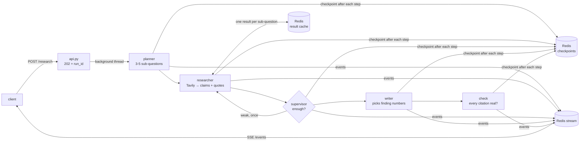

# Multi-Agent Research Assistant

> **Result:** a topic becomes a cited research report in **~40 s for ~$0.013** (live web, 4 searches, 25 findings from 13 sites). **Every citation is a quote checked word-for-word on the page it came from** — 0 invented URLs across all runs. A run killed with `kill -9` (process *or* API server) **resumes with 0 repeated LLM calls**, and a run over budget stops cleanly with a partial report.

Planner → Researcher → Supervisor → Writer → citation check, as a LangGraph graph whose state is saved to Redis after every step. Served by FastAPI with live progress over Server-Sent Events.

## Results

| Test | Result |
|---|---|
| Live run, "Should a 10-person startup use Kubernetes?" | 39.8 s, 25,712 tokens (~$0.013 with `gpt-4.1-mini`) + 4 Tavily searches → 25 findings from 13 sites, 3 sections |
| Quote check (Researcher) | 5 of 30 claims dropped in that run: their quote was not on the page |
| Citation check (final gate) | all citations verified, 0 removed, on every run since it was added (e.g. 9/9); 4 unit tests prove it catches an invented URL, a reworded claim and an unfetched page |
| Search times out (simulated) | named `timeout`, retried once, 0 tokens spent; the Supervisor re-searched with a new query → 8 findings; run finished in 61.6 s |
| `kill -9` the pipeline after sub-question 2 | resume: q1, q2 **from cache**, q3, q4 new → 0 repeated LLM calls |
| `kill -9` the API server mid-run | restart marks the run `interrupted` → `POST /resume` → q1, q2 from cache → report |
| Token budget 3,000 | stopped before q3, used 2,721, still wrote a report (`stopped: tokens`) |
| Token budget 1,500 | stopped after planning, 369 tokens, no report, no crash |
| Pages | 25 pages used, 25 unique, max 2 per site |

12 tests: `uv run pytest -q` (search filters and failures, the result cache, the citation gate).

## Architecture



Everything about a run is filed in Redis under its `run_id`: `run:{id}` (status), `checkpoint:{id}…` (state after each step, for resume), `result:{id}:research:…` (one saved result per sub-question), `events:{id}` (the progress feed).

## Design decisions

1. **Typed handoffs, no persona prompts.** Agents pass Pydantic objects (`Plan`, `Finding`, `Report`), so a malformed handoff fails at once instead of three steps later. Prompts state the task and rules only.
2. **A claim needs a quote, and code checks the quote.** The Researcher must copy the exact supporting sentence; code looks for it on the full page and drops the claim if it isn't there. Trade-off: some true claims are dropped when the LLM trims a quote.
3. **The Writer never writes a citation.** It writes the summary and headings and picks finding *numbers*; code builds the sections from the real findings. A final check node still verifies every citation, so a future change can't quietly break this.
4. **The Supervisor judges; code decides.** It names weak sub-questions and suggests a new query; the pipeline sends work back at most once and checks budgets (sub-questions, searches, tokens with a writer reserve, wall clock) before every search.
5. **Two levels of saving.** LangGraph checkpoints after every node, so a resume starts at the right node; each sub-question's result is also saved under `(run_id, question)`, so a node that was killed halfway repeats no finished work. Failed searches are not saved, so they are retried.
6. **One API server, async jobs.** `POST` returns a run id and the run happens in a thread; events go to a Redis stream, so clients can watch, join late or reconnect with `Last-Event-ID`. At startup, runs left `running` by a dead server are marked `interrupted`. Trade-off: this assumes one server; several would need a lease/heartbeat per run.

## What did not work

- **The first budget leaked 2×.** Cap 1,500, spent 3,293: the budget was checked before each step, but the writer still ran after the stop. Fix: keep a writer reserve.
- **The first live run went 50% over budget** (30,519 on 20,000) because the writer copied 26 findings with their quotes. Fix: the writer picks numbers; budget raised to 40k (~6k tokens per live search).
- **Resume crashed at first.** Pydantic objects came back from Redis as wrapper dicts. Fix: the state holds plain JSON; nodes rebuild objects when they read.
- **Resume repeated paid work.** The researcher is one node, so sub-questions finished before a kill were searched again. Fix: the per-sub-question result cache.
- **A killed API server left runs stuck at `running`**, and resume refused them (409). Fix: mark them `interrupted` at startup.
- **Still weak:** the Researcher sometimes adds words its quote doesn't say ("for startups" on an ML-team page); the planner can produce overlapping sub-questions; the token count is in+out together, so cost is an estimate.
- **Caveat on the crash tests:** Tavily's API stopped resolving (DNS) during those steps, so the kill/resume and API tests ran on fixed fake pages with real LLM calls. The live numbers above are from earlier runs of the same pipeline.

## Setup

Requires Python 3.12, [uv](https://docs.astral.sh/uv/) and Docker.

```bash
cp .env.example .env              # add OPENAI_API_KEY and TAVILY_API_KEY
docker compose up -d              # Redis 8 (JSON + search modules)
uv sync

# command line: state saved to Redis after every step
uv run python src/pipeline.py start run-1 "Should a 10-person startup use Kubernetes?"
uv run python src/pipeline.py resume run-1        # after a crash

# API
uv run uvicorn api:app --app-dir src --port 8001
./demo.sh "Should a 10-person startup use Kubernetes?"
```

| Endpoint | |
|---|---|
| `POST /research` `{"topic": ...}` | 202 + `run_id`, runs in the background |
| `GET /research/{id}` | status, outcome, tokens, citation check, report |
| `GET /research/{id}/events` | live progress (SSE); honours `Last-Event-ID` |
| `GET /research/{id}/trace` | every event with its time, budgets used, failures, citation check |
| `POST /research/{id}/resume` | continue an interrupted or failed run |

Testing without web search: `SEARCH_STUB=1` (fixed pages). Simulate a failure: `SEARCH_SIMULATE=timeout@2`.
